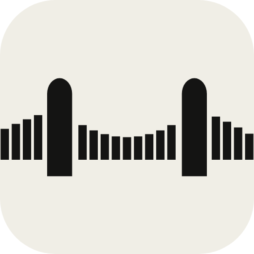
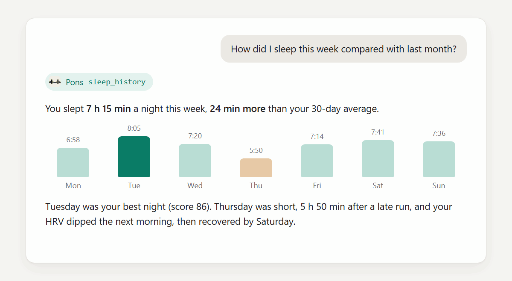
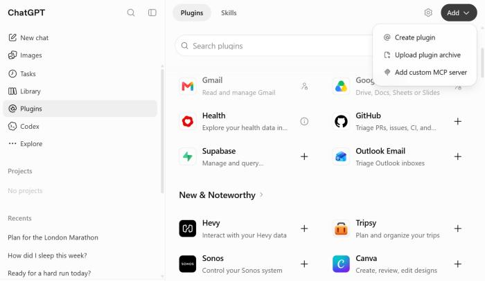
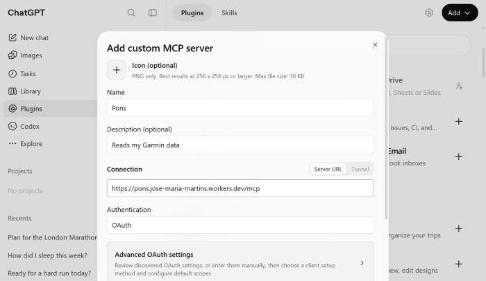
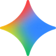

<p align="center"></p>

<h1 align="center">Pons</h1>

<p align="center">
  <b>Every run. Every night. Every heartbeat. Now one question away.</b><br>
  Connect your Garmin to Claude or ChatGPT and use AI as your coach: detailed insights into your training, sleep and recovery.
</p>

<p align="center">
  <a href="https://github.com/Jose-Maria-Martins/pons/actions/workflows/ci.yml"></a>
  <a href="LICENSE"></a>
</p>

<p align="center"></p>

## Use AI as your coach

> *"Make me a 16-week plan for the London Marathon, based on my current fitness."*

- *"How did I sleep this week compared with last month?"*
- *"Am I recovered enough for a hard run today?"*
- *"How did my marathon go, lap by lap?"*
- *"When did my Body Battery drop today, and why?"*

Your AI reads what it needs from Garmin Connect and answers in plain language, compared with your own history.

## Get started

Pons is a Garmin MCP server: it connects Garmin Connect to AI apps through [MCP](https://modelcontextprotocol.io), the open standard for plugging your data into an AI. You add it once with this address:

```
https://pons.jose-maria-martins.workers.dev/mcp
```

<details open>
<summary><picture></picture> <b>Claude</b>: one link, about a minute</summary>

Every plan works; the Free plan allows one custom connector. Add it once on the web or desktop app and it also works in the phone app.

1. Open [this link](https://claude.ai/customize/connectors?modal=add-custom-connector&connectorName=Pons&connectorUrl=https%3A%2F%2Fpons.jose-maria-martins.workers.dev%2Fmcp) in your browser. It opens Claude's "Add custom connector" window with Pons filled in. (Or go to **Customize**, **Connectors**, choose **Add custom connector** and paste the address.)
2. Leave the advanced settings as they are and click **Add**, then **Connect**.
3. Sign in with your Garmin email and password on the Pons page. If Garmin sends you a code, enter it there.
4. Back in Claude, ask a question.

</details>

<details>
<summary><picture><source media="(prefers-color-scheme: dark)" srcset="docs/logos/openai-white.svg"></picture> <b>ChatGPT</b>: a short form, once</summary>

Works on the free plan too. ChatGPT has no ready-made link, so it takes a few fields, once, on chatgpt.com in a browser.

1. Save [the Pons icon](https://pons.jose-maria-martins.workers.dev/icon.png) to your computer. ChatGPT can't change the icon later.
2. Open [ChatGPT's Plugins page](https://chatgpt.com/plugins), click **Add** and choose **Add custom MCP server**.

   

3. Fill in the form:
   - **Icon:** the file you saved
   - **Name:** Pons
   - **Description:** Reads my Garmin data
   - **Server URL:** the address above
   - **Authentication:** OAuth

   

4. Tick **I understand and want to continue**, choose **Create as a plugin**, then install it from your plugins and sign in to Garmin on the page that opens.
5. In a chat, type **@** and pick Pons.

</details>

<details>
<summary><picture></picture> <b>Gemini</b>: not tested yet</summary>

Google allows custom apps for personal Google accounts, 18 or older, in the US, in English, with Keep Activity on.

1. On a computer, open gemini.google.com, then **Settings**, **Connected Apps**, **Add a custom app**.
2. Paste the address. Pons registers itself, so leave the advanced fields empty.
3. Click **Next** and sign in to Garmin. Pons then also works in the Gemini phone app.

</details>

<details>
<summary><b>Other apps</b></summary>

Any app that supports remote MCP servers with OAuth can use the same address. For example, in Claude Code:

```bash
claude mcp add --transport http pons https://pons.jose-maria-martins.workers.dev/mcp
```

</details>

**Disconnecting:** ask your AI to "disconnect Pons". That deletes the stored Garmin login. Then remove the connector in your AI's settings.

## Safe by design

- **Read-only.** Pons can look at your Garmin data. It can't change anything in your account.
- **Your password goes only to Garmin.** Pons never stores it. See [what Pons collects](PRIVACY.md).
- **Nothing to install.** It works in the AI app you already use, on your computer and your phone.

## Why I built it

I bought my Garmin before running the Lisbon Marathon. It's on my wrist 24 hours a day, so it knows more about me than almost anything I own: every run, every night of sleep, every heartbeat.

The first week, the Garmin Connect app amazed me. By the second, I was curious: what more could I learn about myself if an AI could read all of it?

Pons is my answer. Connect your Garmin to your AI and turn all that data into something you can use: smarter training, better recovery, better sleep.

## Questions?

Curious how Pons works, or want to run your own copy? Read [how Pons works](docs/development.md), or point your AI at this repository and ask it.
